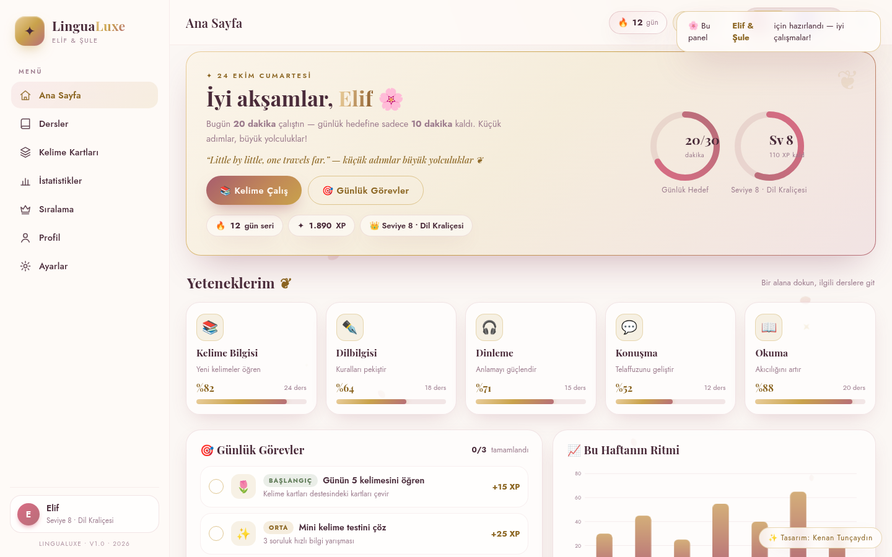
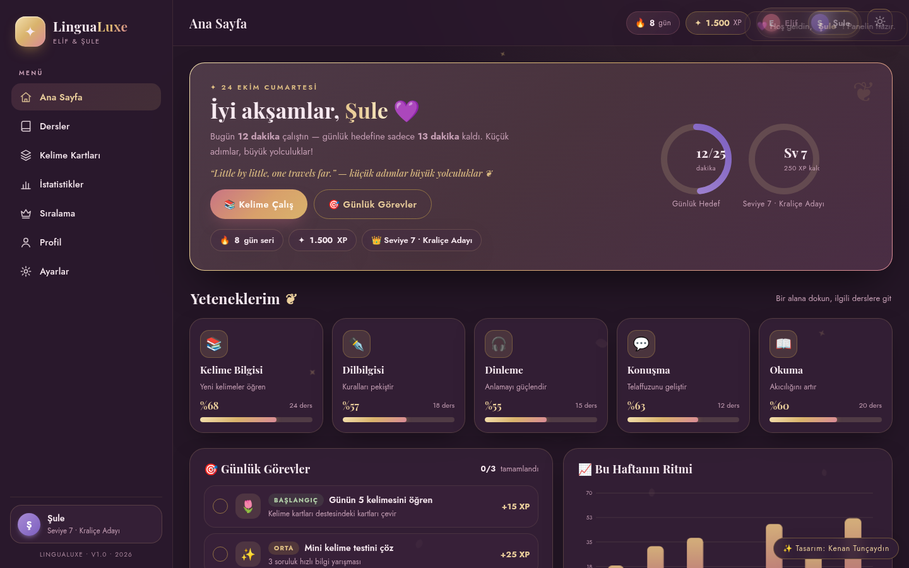
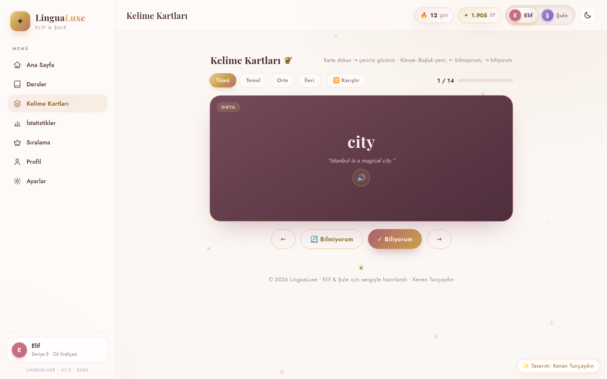
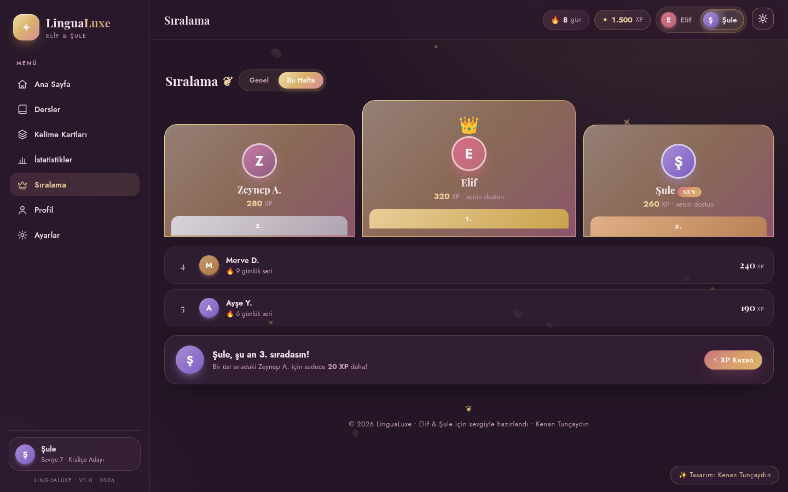
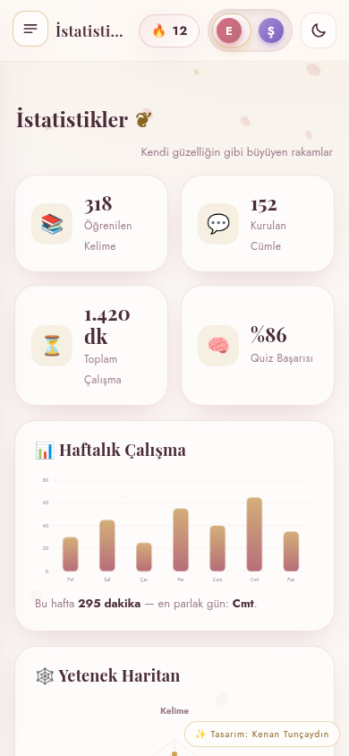

# ✨ LinguaLuxe — İngilizce Öğrenme Paneli (Elif & Şule)

> **Tasarım: Kenan Tunçaydın** • V1.0 • 2026

Türkischsprachige Single-File-Web-App zum Englischlernen — **explizit für Elif & Şule** personalisiert.
Feminines Luxus-Design (Rose-Gold, Champagner, Creme) mit Wow-Effekt — wie eine Premium-Beauty-Marke,
die zufällig eine Lern-App ist. 🌸👑

| Ana Sayfa (Açık) | Ana Sayfa (Koyu) |
|---|---|
|  |  |

---

## 🚀 Kurulum / Start (10 Sekunden)

Kein Build, keine Abhängigkeiten, kein Framework:

1. `index.html` herunterladen
2. Im Browser doppelklicken — fertig. ✅

> İnternet olmadan da çalışır (yalnızca yazı tipi Google Fonts'tan gelir; çevrimdışıysa zarif sistem yazı tipleri kullanılır).

---

## 🌸 Özellikler / Funktionen

### 👭 İki kişiye özel
- **Elif** (Rosé-Akzent) & **Şule** (Lavendel-Akzent) — Kopfzeile-Toggle mit Perlen-Effekt
- Her kullanıcıya kendi ilerlemesi, rozetleri ve istatistikleri (LocalStorage'da saklanır)
- Sıralamada ikisi vurgulanır, aktif kullanıcı **SEN** rozeti taşır

### 📚 7 Sayfa
| Sayfa | İçerik |
|---|---|
| **Ana Sayfa** | Zaman dilimine göre selamlama (altın parıltı animasyonlu), günlük hedef ringi, 5 yetenek kartı, 3 günlük görev (Başlangıç/Orta/İleri) + quiz, mini kelime kartı, hafta grafiği |
| **Dersler** | 8 ünite — tamamlanan / devam eden / kilitli |
| **Kelime Kartları** | 14 kart, 3D-flip (TR↔EN), sesli telaffuz, "Biliyorum/Bilmiyorum", ilerleme + konfeti |
| **İstatistikler** | 4 istatistik karosu, hafta sütun grafiği, 30 günlük SVG çizgi grafiği, 5 yetenek radar grafiği |
| **Sıralama** | Genel/Haftalık, altın-gümüş-bronz podyum 👑, canlı XP farkı |
| **Profil** | Avatar, biyografi, seviye ("Dil Kraliçesi"), 8 rozet |
| **Ayarlar** | Tema, günlük hedef sürgüsü, ses & yaprak efekti, verileri sıfırlama |

### ✨ Ekstralar
- ☀️🌙 **Açık/Koyu tema** — her ikisi de lüks (krem-ellips → derin patlıcan-mor)
- 🎊 **Altın konfeti** + yumuşak WebAudio sesler (kapatılabilir)
- 🔢 Count-up animasyonları, sayfa geçişleri, shimmer efektleri
- ♿ `prefers-reduced-motion` desteği
- 📱 Tam responsive — mobilde hamburger menü (< 900px)
- 💾 LocalStorage kalıcılığı + Ayarlar'dan sıfırlama

---

## 🖼️ Ekran Görüntüleri

| | |
|---|---|
|  |  |
|  | |

---

## 🛠️ Teknik

- **1 dosya**: `index.html` (~99 KB) — tüm CSS & JS inline, sıfır framework
- Saf HTML + CSS + Vanilla JS (SPA, hash'siz görünüm yönetimi)
- Grafikler: el yapımı SVG/CSS (kitaplıksız)
- Ses: WebAudio API • Telaffuz: SpeechSynthesis (en-US)
- Yazı tipleri: Playfair Display (serif başlıklar) + Jost (gövde), sistem yedekleriyle

---

## 🇩🇪 Über dieses Projekt (Deutsch)

Single-File-Web-App zum Englischlernen, maßgeschneidert für die beiden türkischsprachigen
Freundinnen **Elif & Şule**. Komplett türkische Benutzeroberfläche, feminines Edel-Design
(Rose-Gold, Champagner-Gold, Creme / Aubergine im Dark Mode), 3D-Flashcards, Quiz-Aufgaben,
Charts, Leaderboard, Badges — ohne Framework, ohne Build, ohne Abhängigkeiten.

**Erstellt von Kenan Tunçaydın** ✒️

---

`✨ Tasarım: Kenan Tunçaydın — Elif & Şule için sevgiyle hazırlandı 💛`

